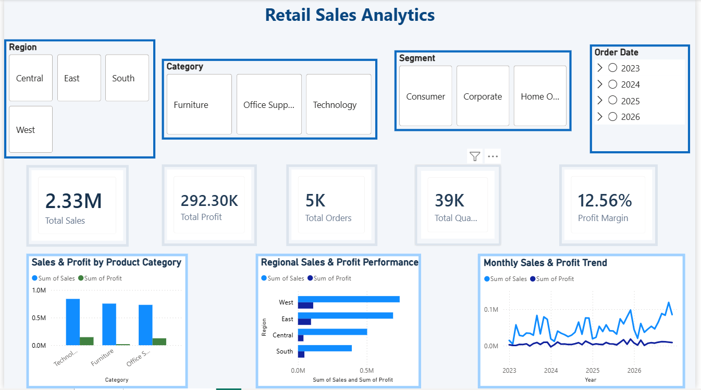

# Retail Sales Analytics

### An End-to-End Data Analytics Project Using Python, SQL, Excel, and Power BI

## 1. Project Overview

Retail Sales Analytics is an end-to-end data analytics project that examines retail transactions to understand sales performance, profitability, regional differences, product category performance, and discount-related losses.

The project combines Python for data preparation and exploratory data analysis, SQL for business analysis, Excel for PivotTables and KPI analysis, and Power BI for interactive dashboards and business recommendations.

The objective is to transform raw transaction data into meaningful insights that support data-driven business decisions.

## 2. Business Problems

This project investigates the following business questions:

- What are the overall sales, profit, and profit margin?
- Which product categories generate the most sales and profit?
- Which regions contribute the most to profitability?
- Which product subcategories generate losses?
- How do sales and profit change over time?
- Are high discounts associated with lower profitability?
- How can interactive dashboards help stakeholders explore business performance?

## 3. Project Objectives

- Inspect, clean, and validate retail transaction data.
- Perform exploratory data analysis using Python.
- Store cleaned data in a SQLite database.
- Use SQL aggregation and window functions for business analysis.
- Perform statistical tests to investigate discount-related profitability differences.
- Build Excel PivotTables, charts, and KPI summaries.
- Develop interactive Power BI dashboards and recommendations.
- Document the workflow for reproducibility.

## 4. Dataset Description

The project uses a Superstore retail sales dataset containing 10,194 transaction rows and 21 columns.

Important fields include:

| Field | Description |
|---|---|
| Order ID | Order identifier |
| Order Date | Date the order was placed |
| Ship Date | Date the order was shipped |
| Customer ID | Customer identifier |
| Segment | Customer segment |
| Region | Sales region |
| Category | Product category |
| Sub-Category | Product subcategory |
| Sales | Sales amount |
| Profit | Profit or loss |
| Quantity | Quantity sold |
| Discount | Discount applied |

The dataset is used for analytical and educational purposes.

## 5. Tools and Technologies

| Technology | Purpose |
|---|---|
| Python | Data inspection, cleaning, and analysis |
| Pandas | Data manipulation and preparation |
| Matplotlib | Exploratory data visualizations |
| SciPy | Statistical hypothesis testing |
| SQLite | Local database storage |
| SQL | Business analysis and window functions |
| Microsoft Excel | PivotTables, charts, and KPI calculations |
| Power BI Desktop | Interactive dashboards and recommendations |
| Git and GitHub | Version control and project sharing |

## 6. Project Workflow

### Step 1: Data Inspection

Inspected the source dataset to understand its structure, fields, data types, and potential data-quality issues.

### Step 2: Data Cleaning

Used Python to standardize data, trim text values, remove exact duplicate rows, convert date and numeric fields, and inspect potential data-quality issues.

The cleaned dataset was exported to CSV format.

### Step 3: Exploratory Data Analysis

Used Python to generate charts and summary statistics to explore sales, profit, categories, regions, and discount patterns.

### Step 4: Database Creation

Loaded the cleaned dataset into SQLite to support structured SQL analysis.

### Step 5: SQL Business Analysis

Developed SQL queries covering:

- Overall sales, profit, quantity, and profit margin
- Category and regional performance
- Loss-making product subcategories
- Top products and customer segments
- Shipping mode performance
- Monthly sales and profit
- Discount-level profitability
- Running totals using `SUM() OVER()`
- Profitability rankings using `RANK()` and `DENSE_RANK()`
- Year-over-year comparisons using `LAG()`

### Step 6: Excel Analysis

Created PivotTables, charts, and KPI calculations to investigate category performance, regional performance, monthly trends, and discount-level profitability.

### Step 7: Statistical Analysis

Used Python and SciPy to compare records with discounts of 30% or less against records with discounts above 30%.

The analysis includes descriptive statistics, Welch's independent-samples t-test, and the Mann–Whitney U test.

The initial tests operate at the individual sales-record level. Multiple records can belong to the same order, so the independence assumption may be violated. The results should therefore be treated as preliminary evidence of an association, not proof of causation.

### Step 8: Power BI Dashboard

Developed an interactive dashboard with KPI cards, category comparisons, regional performance, monthly trends, and slicers for exploring the data.

### Step 9: Power BI Recommendations

Added a separate Recommendations page with business actions related to:

- Reviewing high-discount transactions
- Investigating loss-making subcategories
- Protecting profitability in high-performing subcategories
- Monitoring sales growth alongside profit growth

The recommendations are based on the current dataset analysis and should be reviewed alongside data-quality and statistical limitations.

## 7. Key Business Findings

The following figures were calculated from the current cleaned dataset.

| Metric | Result |
|---|---:|
| Total Sales | 2,326,534.35 |
| Total Profit | 292,296.81 |
| Total Quantity Sold | 38,654 |
| Profit Margin | 12.56% |
| Total Distinct Orders | 5,111 |
| Transaction Rows | 10,194 |

**Note:** The dataset contains order dates through December 2026. Because those dates extend beyond the current date of October 31, 2026, the future-dated records should be investigated before the results are described as strictly historical performance.

### Category Performance

Technology generated the highest sales and profit among the three product categories.

| Category | Sales | Profit |
|---|---:|---:|
| Technology | 839,893.28 | 146,543.38 |
| Furniture | 754,747.76 | 19,730.00 |
| Office Supplies | 731,893.31 | 126,023.44 |

### Regional Performance

The West region recorded the highest sales and profit among the four regions.

| Region | Sales | Profit |
|---|---:|---:|
| West | 739,813.61 | 110,798.82 |
| East | 691,828.17 | 94,883.26 |
| Central | 503,170.67 | 39,865.31 |
| South | 391,721.91 | 46,749.43 |

### Loss-Making Subcategories

Three subcategories reported negative total profit.

| Subcategory | Sales | Profit |
|---|---:|---:|
| Tables | 208,020.18 | -17,753.21 |
| Bookcases | 115,361.20 | -3,632.07 |
| Supplies | 46,725.50 | -1,171.39 |

### Subcategory Profitability Ranking

The SQL ranking analysis identified Copiers as the highest-profit subcategory, with total profit of 56,093.94.

Phones ranked second, with total profit of 45,050.83.

These findings demonstrate why sales revenue and profit should be evaluated separately.

### Discount and Profitability Analysis

The initial record-level analysis produced the following results:

| Metric | Discount ≤ 30% | Discount > 30% |
|---|---:|---:|
| Record count | 9,009 | 1,185 |
| Mean profit per record | 46.38 | -105.91 |
| Median profit per record | 10.89 | -17.25 |
| Total profit | 417,804.05 | -125,507.24 |

The difference in average profit was -152.29 per record when comparing the above-30% group with the 30%-or-less group.

Both Welch's t-test and the Mann–Whitney U test reported statistically significant differences in the initial analysis.

**Interpretation caution:** These are record-level comparisons, and multiple records may belong to the same order. Further analysis should account for order-level dependence and other potential confounding factors. Statistical association does not establish causation.

## Reporting Period and Year-over-Year Analysis

### Reporting Period

The supplied dataset contains order dates from January 3, 2023, through December 30, 2026. For reporting as of October 31, 2026, records after that date are excluded from the cutoff-based analysis.

The original source data is preserved. Future-dated records are not automatically deleted because they are present in both the raw and cleaned datasets.

### January–October Comparison

| Metric | Jan–Oct 2025 | Jan–Oct 2026 |
|---|---:|---:|
| Records | 1,898 | 2,437 |
| Sales | 437,019.34 | 541,937.99 |
| Profit | 60,727.49 | 77,578.42 |
| Profit Margin | 13.90% | 14.31% |

**Key findings from the supplied dataset:**
- Sales increased by 24.01%.
- Profit increased by 27.75%.
- Profit margin improved by approximately 0.42 percentage points.

These results are based on the supplied dataset and do not independently establish actual business performance.

### Analytical Consideration

A partial-year total should not be directly compared with a full-year total to determine year-over-year growth. The January–October comparison uses matching reporting periods to provide a more meaningful comparison.

The source dataset's provenance and completeness have not been independently verified.
## 8. Power BI Dashboard Features

The main dashboard includes:

- Total Sales KPI
- Total Profit KPI
- Total Orders KPI
- Total Quantity KPI
- Profit Margin KPI
- Sales and profit by category
- Regional sales and profit performance
- Monthly sales and profit trends
- Region slicer
- Category slicer
- Segment slicer
- Order Date slicer

The separate Recommendations page presents business actions derived from the analysis.

### Dashboard Preview



### Power BI Report

[Open the Power BI report file](powerbi/Retail_Sales_Analytics.pbix)

**Requirement:** The `.pbix` file must be opened using Power BI Desktop.

## 9. Project Structure

```text
Retail-Sales-Analytics/
├── data/
│   ├── raw/
│   │   └── sample_-_superstore.xls
│   └── processed/
│       ├── superstore_cleaned.csv
│       └── retail_sales.db
├── scripts/
│   ├── inspect_data.py
│   ├── clean_data.py
│   ├── eda_analysis.py
│   ├── load_sqlite.py
│   ├── run_sql_analysis.py
│   └── discount_hypothesis_test.py
├── sql/
│   └── business_analysis.sql
├── excel/
│   └── Retail_Sales_Analysis.xlsx
├── powerbi/
│   ├── Retail_Sales_Analytics.pbix
│   └── dashboard_screenshot.png
├── reports/
│   ├── eda_charts/
│   └── statistical_analysis/
│       ├── discount_group_summary.csv
│       └── discount_test_results.txt
└── README.md
```

This structure reflects the intended project layout. Confirm that the listed files exist in your local repository before committing the README.

## 10. Setup and Installation

### Requirements

- Python 3
- Power BI Desktop for opening and exploring the `.pbix` report
- Git for version control (optional if downloading the project as a ZIP)

### Step 1: Open the project directory

Open a terminal in the project root:

```powershell
cd D:\Resume_prjs\Retail-Sales-Analytics
```

### Step 2: Create a virtual environment

```powershell
python -m venv .venv
```

Activate it in Windows PowerShell:

```powershell
.\.venv\Scripts\Activate.ps1
```

If PowerShell blocks activation, you can use Command Prompt instead:

```bat
.venv\Scripts\activate.bat
```

### Step 3: Install the Python dependencies

```powershell
python -m pip install --upgrade pip
python -m pip install pandas matplotlib openpyxl xlrd scipy
```

### Step 4: Run the analysis scripts

Run these commands from the project root, in order:

```powershell
python scripts/inspect_data.py
python scripts/clean_data.py
python scripts/eda_analysis.py
python scripts/load_sqlite.py
python scripts/run_sql_analysis.py
python scripts/discount_hypothesis_test.py
```

The source dataset must be available at the path and filename expected by the scripts.

The inspection, cleaning, and database-loading scripts should be run before the downstream analyses when rebuilding the project from raw data.

### Step 5: Open the Excel workbook

Open:

`excel/Retail_Sales_Analysis.xlsx`

Use the workbook to explore PivotTables, KPI calculations, and charts.

### Step 6: Open the Power BI report

Open:

`powerbi/Retail_Sales_Analytics.pbix`

Use Power BI Desktop to explore the dashboard and Recommendations page.

## 11. Limitations

- Results describe the available dataset and may not generalize to every retail business.
- Future-dated records require investigation before final historical reporting.
- The initial discount tests compare individual sales records and may violate the independence assumption when records share an order.
- The statistical findings show association, not proof of causation.
- The initial analysis is descriptive and does not establish causal relationships.
- Further analysis could account for order-level dependence, product mix, customer characteristics, and other factors.

## 12. Future Improvements

Potential enhancements include:

- Order-level statistical analysis of discount and profit relationships.
- Product-level profitability and pricing analysis.
- More detailed customer segmentation.
- Additional data-quality checks and date validation.
- Automated data refresh and report generation.
- More advanced business intelligence measures.

## 13. Conclusion

This project demonstrates an end-to-end retail analytics workflow, from raw data inspection and cleaning to SQL analysis, Excel reporting, statistical testing, and interactive Power BI dashboards.

It combines technical analysis with business recommendations to demonstrate how retail transaction data can be transformed into useful insights.

## Author

Developed as a data analytics portfolio project demonstrating Python, SQL, Excel, Power BI, and statistical analysis skills.